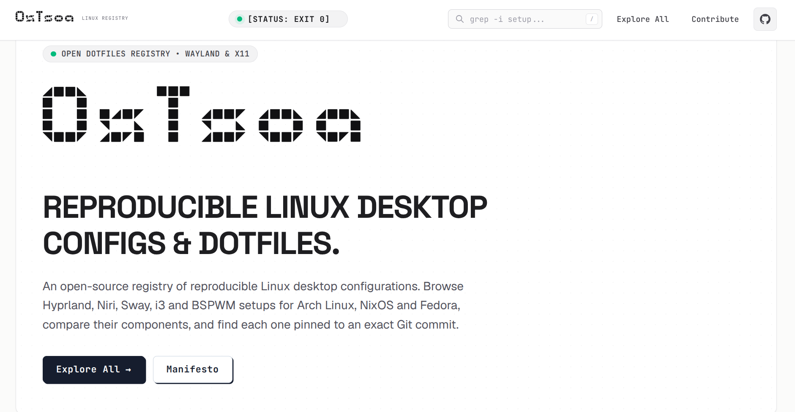
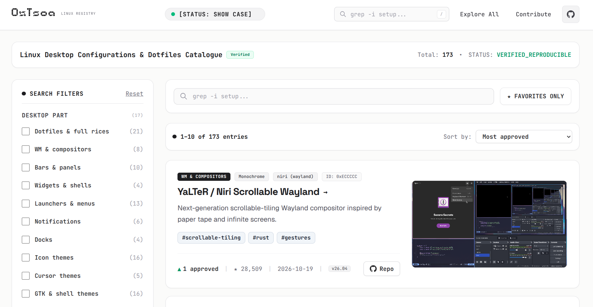
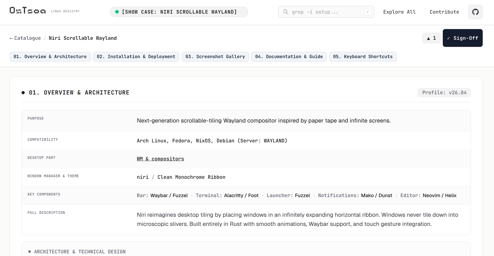
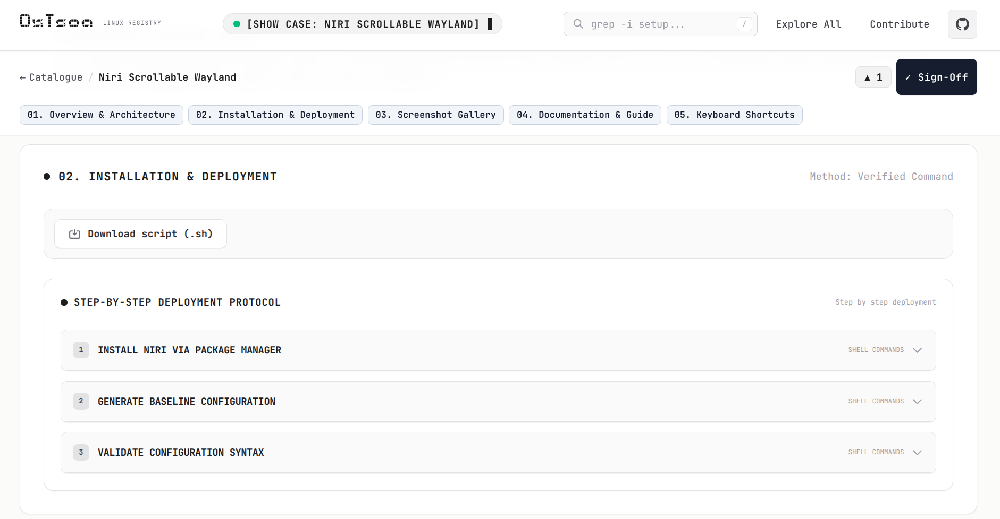
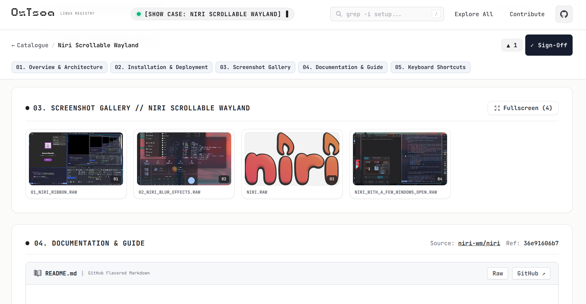
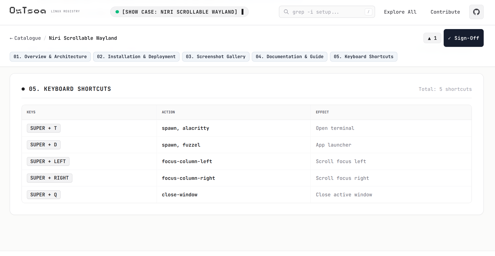
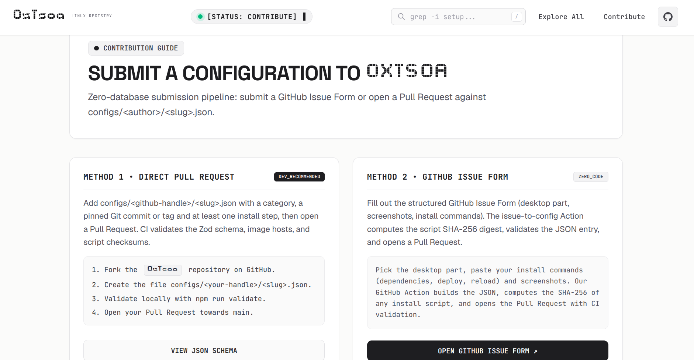
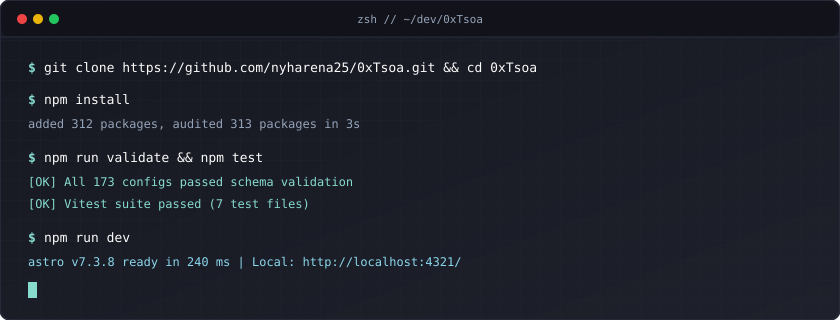

<div align="center">

  <a href="https://www.0xtsoa.dev">
    
  </a>

  <h3>LINUX DESKTOP ARCHITECTURE MADE SIMPLE.</h3>

  <p>
    <a href="https://www.0xtsoa.dev">
      
    </a>
  </p>

  <p>
    0xTsoa (pronounced ZeroTsoa) is an open-source registry of Linux desktop configurations.
  </p>

  <p>
    <a href="https://www.0xtsoa.dev">
      
    </a>
    <a href="https://github.com/nyharena25/0xTsoa/actions/workflows/validate.yml">
      
    </a>
    <a href="https://github.com/nyharena25/0xTsoa/stargazers">
      
    </a>
    <a href="https://www.0xtsoa.dev/index.json">
      
    </a>
    <a href="./LICENSE">
      
    </a>
  </p>

  <p>
    <a href="https://www.0xtsoa.dev/"><b>Explore Platform</b></a> ·
    <a href="https://www.0xtsoa.dev/catalogue/"><b>Browse Catalogue</b></a> ·
    <a href="#what-is-0xtsoa"><b>What is 0xTsoa</b></a> ·
    <a href="#key-highlights"><b>Key Highlights</b></a> ·
    <a href="#visual-showcase"><b>Visual Showcase</b></a> ·
    <a href="#how-it-works"><b>How It Works</b></a> ·
    <a href="#tech-stack"><b>Tech Stack</b></a> ·
    <a href="#quick-start"><b>Quick Start</b></a> ·
    <a href="#submitting-a-setup"><b>Submit a Setup</b></a> ·
    <a href="#community"><b>Community</b></a>
  </p>

  <p>
    
  </p>

</div>

<picture>
  <source media="(prefers-color-scheme: dark)" srcset=".github/assets/section-divider-dark.svg">
  <source media="(prefers-color-scheme: light)" srcset=".github/assets/section-divider.svg">
  
</picture>

<a id="what-is-0xtsoa"></a>
## <picture><source media="(prefers-color-scheme: dark)" srcset=".github/assets/icons/info-dark.svg"></picture> What is 0xTsoa

0xTsoa (pronounced ZeroTsoa) is an open-source registry of Linux desktop configurations. It indexes complete dotfile setups alongside individual desktop components: window managers, compositors, status bars, widget engines, application launchers, notification daemons, docks, icon and cursor packs, GTK themes, color scheme generators, display managers, lock screens, boot themes, desktop extensions, ricing tools, and curated guides.

Every entry is a human-readable JSON file in `configs/<author>/<slug>.json`, validated against a strict Zod schema and referencing an upstream commit SHA or version tag. At build time, Astro compiles the registry into a static website, [0xtsoa.dev](https://www.0xtsoa.dev): no database, no backend, just Git.

Each configuration page brings together everything needed to inspect and reproduce a desktop:

- **Overview**: purpose, supported distributions, display server, window manager, key components, and assurance badges (**Schema validated**, **Source pinned**, **Script hash-checked**, **Install reviewed**).
- **Installation**: step-by-step commands that check out `{{ref}}`, plus a downloadable script.
- **Screenshots and documentation**: a gallery and the upstream README rendered at `source.ref`.
- **Keyboard shortcuts** and a **community upvote** counter backed by a GitHub issue.

<picture>
  <source media="(prefers-color-scheme: dark)" srcset=".github/assets/section-divider-dark.svg">
  <source media="(prefers-color-scheme: light)" srcset=".github/assets/section-divider.svg">
  
</picture>

<a id="key-highlights"></a>
## <picture><source media="(prefers-color-scheme: dark)" srcset=".github/assets/icons/sparkles-dark.svg"></picture> Key Highlights

- <picture><source media="(prefers-color-scheme: dark)" srcset=".github/assets/icons/server-dark.svg"></picture> **100% Static and Zero-Database**: No database or backend session servers. Every desktop environment specification lives in an audit-ready, typed JSON file inside `configs/<author>/<slug>.json`.
- <picture><source media="(prefers-color-scheme: dark)" srcset=".github/assets/icons/shield-check-dark.svg"></picture> **Three Separate Levels of Assurance**: Every entry is **Schema validated** (Zod schema, allowlisted screenshot hosts, and `{{ref}}` checkout in `git clone` steps). Entries using a 40-character commit SHA in `source.ref` are **Source pinned** (unlike Git tags, which can be moved upstream). Entries with an optional `install.script` are **Script hash-checked** (SHA-256 digest and 1 MiB limit checked in CI), and entries with `review.installReviewed` show who manually reviewed the install steps.
- <picture><source media="(prefers-color-scheme: dark)" srcset=".github/assets/icons/check-circle-dark.svg"></picture> **GitHub Issues Upvote Engine**: Each configuration has a dedicated GitHub issue labeled `vote` (`[0xTsoa] <author>/<slug>`). `+1` reactions (one per GitHub user) are tallied at build time into `src/generated/votes.json` and drive the Top 5 Spotlight.
- <picture><source media="(prefers-color-scheme: dark)" srcset=".github/assets/icons/refresh-cw-dark.svg"></picture> **Sanitized README Snapshot & Nightly Upstream Sync**: Fetches and sanitizes upstream README files at `source.ref`, translates volatile `private-user-images.githubusercontent.com` links into permanent `github.com/user-attachments/assets/<uuid>` URLs, resolves relative paths, and opens a nightly pull request (`bot/upstream-sync`) when upstream refs advance while updating `src/generated/repo-stats.json`.
- <picture><source media="(prefers-color-scheme: dark)" srcset=".github/assets/icons/palette-dark.svg"></picture> **Neo-Brutalist Paper and Ink Design**: High-contrast, WCAG AAA accessible interface built with *Space Grotesk*, *Geist Variable*, *JetBrains Mono Variable*, and custom *BD Brick* typography.
- <picture><source media="(prefers-color-scheme: dark)" srcset=".github/assets/icons/search-dark.svg"></picture> **Instant Client Filtering and Offline Search**: Multi-facet filtering across 17 desktop categories, 21 window managers, 14 aesthetic styles, and 13 distributions, paired with Pagefind static full-text search and a public `/index.json` catalogue endpoint.

<picture>
  <source media="(prefers-color-scheme: dark)" srcset=".github/assets/section-divider-dark.svg">
  <source media="(prefers-color-scheme: light)" srcset=".github/assets/section-divider.svg">
  
</picture>

<a id="visual-showcase"></a>
## <picture><source media="(prefers-color-scheme: dark)" srcset=".github/assets/icons/image-dark.svg"></picture> Visual Showcase

<div align="center">

### 01. Home
<p>Registry landing page with quick search, the community Spotlight and shortcuts by window manager and style.</p>


<br/><br/>

### 02. Catalogue and Filters
<p>Every entry in one list, filterable by desktop part, window manager, theme style and distribution, and sortable by approvals, date or upstream stars.</p>


<br/><br/>

### 03. Configuration Overview
<p>Purpose, compatibility, desktop part, window manager, theme and key components of a setup, with its community upvote counter.</p>


<br/><br/>

### 04. Installation and Deployment
<p>Step-by-step install commands (dependencies, deploy, reload) pinned to the recorded commit, plus a downloadable shell script.</p>


<br/><br/>

### 05. Screenshot Gallery and Upstream README
<p>Fullscreen screenshot gallery and the project's README, rendered and sanitized at the pinned commit.</p>


<br/><br/>

### 06. Keyboard Shortcuts
<p>The setup's key bindings at a glance: keys, action and effect.</p>


<br/><br/>

### 07. Contribute
<p>Two ways to submit a setup: a direct pull request, or a GitHub issue form that the bot turns into a pull request.</p>


</div>

<picture>
  <source media="(prefers-color-scheme: dark)" srcset=".github/assets/section-divider-dark.svg">
  <source media="(prefers-color-scheme: light)" srcset=".github/assets/section-divider.svg">
  
</picture>

<a id="how-it-works"></a>
## <picture><source media="(prefers-color-scheme: dark)" srcset=".github/assets/icons/cpu-dark.svg"></picture> How It Works

0xTsoa operates entirely through Git and GitHub Actions without any external database:

1. **Submission**: A contributor submits the **Submit a Linux Desktop Project** issue form (`new-config.yml`) or opens a pull request adding `configs/<author>/<slug>.json`.
2. **Automated PR Generation (`issue-to-pr.yml`)**: When an issue labeled `new-config` is opened (or relabeled `regenerate` by a maintainer after edits), `scripts/issue-to-config.ts` parses the markdown fields, computes the SHA-256 hash of any external `.sh` installer if omitted, validates the resulting JSON against `src/lib/schema.ts`, and opens a pull request on branch `config/issue-<number>` (or comments any validation errors back onto the issue).
3. **Validation (`validate.yml`)**: On every pull request and push to `main`, `scripts/validate-configs.ts --scripts` verifies directory and slug format, duplicate/case-colliding IDs, `author.github` folder match, the Zod schema (including `{{ref}}` checkout in `git clone` steps), allowed screenshot domains, and any `install.script` SHA-256 hashes. On pull requests touching `configs/**`, it also runs `--network --only` on the changed configs, runs the Vitest suite, and performs an Astro build.
4. **Nightly Upstream Sync (`sync-upstream.yml`)**: Every night at `02:23 UTC`, `scripts/sync-upstream.ts` queries `git ls-remote` across all indexed repositories, updates `source.ref` to the latest default-branch commit SHA (leaving `updatedAt` untouched), sets `version` only when a version-like tag's peeled commit matches the new ref, updates star counts in `src/generated/repo-stats.json`, and opens a pull request on branch `bot/upstream-sync` with a compare-link summary.
5. **Vote Issues and Static Build (`deploy.yml`)**: On push to `main` or nightly at `03:17 UTC`, `scripts/ensure-vote-issues.ts` ensures every config has an issue labeled `vote` (created closed, so open issues stay for real reports; reactions still count) and triggers the Vercel deploy hook (`VERCEL_DEPLOY_HOOK`). During the Vercel build, `prebuild` (`scripts/fetch-votes.ts`) counts `+1` reactions into `src/generated/votes.json`, `astro build` renders all static pages and `/index.json`, and `pagefind --site dist` builds the offline search index.

<p align="center">
  
</p>

<picture>
  <source media="(prefers-color-scheme: dark)" srcset=".github/assets/section-divider-dark.svg">
  <source media="(prefers-color-scheme: light)" srcset=".github/assets/section-divider.svg">
  
</picture>

<a id="tech-stack"></a>
## <picture><source media="(prefers-color-scheme: dark)" srcset=".github/assets/icons/layers-dark.svg"></picture> Tech Stack

<p align="center">
  <a href="https://astro.build/">
    
  </a>
  <a href="https://www.typescriptlang.org/">
    
  </a>
  <a href="https://nodejs.org/">
    
  </a>
  <a href="https://pagefind.app/">
    
  </a>
  <a href="https://github.com/features/actions">
    
  </a>
  <a href="https://vitest.dev/">
    
  </a>
</p>

| Layer | Technology | Purpose |
| :--- | :--- | :--- |
| **Static Site Engine** | [Astro 7](https://astro.build/) | Content-driven static site generation with Astro Content Collections |
| **Language and Runtime** | [TypeScript 6](https://www.typescriptlang.org/) and [Node.js >= 20](https://nodejs.org/) | Strictly typed build scripts (`tsx`), schema definitions, and route handlers |
| **Styling and Design** | [Tailwind CSS v4](https://tailwindcss.com/) | Paper and Ink design tokens, WCAG AAA contrast ratios, and responsive layouts |
| **Schema and Validation** | [Zod 4](https://zod.dev/) and [JSON Schema](https://json-schema.org/) | Single-source schema validation (`src/lib/schema.ts` and `schema/config.schema.json`) |
| **Offline Search** | [Pagefind 1.5](https://pagefind.app/) | Static full-text search index generated post-build inside `dist/` |
| **Markdown Pipeline** | [Marked 18](https://marked.js.org/) and [sanitize-html](https://github.com/apostrophecms/sanitize-html) | Safe GitHub Flavored Markdown rendering, alert callouts, and relative URL rewriting |
| **Testing and CI/CD** | [Vitest 5](https://vitest.dev/) and [GitHub Actions](https://github.com/features/actions) | Unit testing, schema verification, automated issue-to-PR bot, and nightly sync |

<picture>
  <source media="(prefers-color-scheme: dark)" srcset=".github/assets/section-divider-dark.svg">
  <source media="(prefers-color-scheme: light)" srcset=".github/assets/section-divider.svg">
  
</picture>

<a id="quick-start"></a>
## <picture><source media="(prefers-color-scheme: dark)" srcset=".github/assets/icons/terminal-dark.svg"></picture> Quick Start

<p align="center">
  
</p>

### Prerequisites
- Node.js `>= 20`
- `npm`

### Local Development

```bash
# 1. Clone the repository
git clone https://github.com/nyharena25/0xTsoa.git
cd 0xTsoa

# 2. Install dependencies
npm install

# 3. Start the local Astro development server (http://localhost:4321/)
npm run dev

# 4. Validate all configs/<author>/<slug>.json files against the schema
npm run validate

# 5. Run Astro type checking and the Vitest unit test suite
npm run check

# 6. Build the production static site and Pagefind index (runs prebuild vote fetch first)
npm run build

# 7. Preview the production build locally
npm run preview
```

### All Available `npm` Scripts (`package.json`)

| Script | Command | Description |
| :--- | :--- | :--- |
| `npm run dev` | `astro dev` | Starts the local development server on `http://localhost:4321/` |
| `npm run prebuild` | `tsx scripts/fetch-votes.ts` | Runs automatically before `npm run build` to fetch `+1` vote counts into `src/generated/votes.json` |
| `npm run build` | `astro build && pagefind --site dist` | Builds the static site to `dist/` and generates the Pagefind search index |
| `npm run preview` | `astro preview` | Serves the built `dist/` folder locally |
| `npm run check` | `astro check && vitest run` | Runs Astro diagnostics and the full Vitest test suite |
| `npm test` | `vitest run` | Executes the Vitest unit test suite in `tests/` |
| `npm run validate` | `tsx scripts/validate-configs.ts` | Validates `configs/<author>/<slug>.json` files (`--scripts` checks script SHA-256 hashes; `--network` checks remote URLs and hashes; `--only <file...>` restricts to given files) |
| `npm run schema` | `tsx scripts/generate-schema.ts` | Regenerates `schema/config.schema.json` from `src/lib/schema.ts` |
| `npm run votes` | `tsx scripts/fetch-votes.ts` | Fetches `+1` reactions on `vote` issues into `src/generated/votes.json` |
| `npm run sync-upstream` | `tsx scripts/sync-upstream.ts` | Updates `source.ref`, matching `version` tags, `src/generated/repo-stats.json`, and writes `sync-summary.md` |
| `npm run vote-issues` | `tsx scripts/ensure-vote-issues.ts` | Creates missing `[0xTsoa] <author>/<slug>` vote issues (requires `GITHUB_TOKEN`) |
| `npm run issue-to-config` | `tsx scripts/issue-to-config.ts` | Converts a `new-config.yml` issue markdown file into `configs/<author>/<slug>.json` |

<picture>
  <source media="(prefers-color-scheme: dark)" srcset=".github/assets/section-divider-dark.svg">
  <source media="(prefers-color-scheme: light)" srcset=".github/assets/section-divider.svg">
  
</picture>

<a id="submitting-a-setup"></a>
## <picture><source media="(prefers-color-scheme: dark)" srcset=".github/assets/icons/git-pull-request-dark.svg"></picture> Submitting a Setup

You can add your Linux desktop setup, theme, bar, launcher, or tool in two ways:

1. **No-Code Issue Form (Recommended)**: Open the [Submit a Linux Desktop Project](https://github.com/nyharena25/0xTsoa/issues/new?template=new-config.yml) issue template. Fill in your repository URL, commit SHA or version tag, screenshot URLs, and installation commands. Our `issue-to-pr.yml` workflow generates `configs/<your-username>/<slug>.json`, computes any missing script SHA-256 checksum, validates the file, and opens a pull request for you.
2. **Direct Pull Request**: Fork the repository, create `configs/<your-github-username>/<slug>.json` conforming to [`schema/config.schema.json`](./schema/config.schema.json), run `npm run validate`, and open a pull request.

Read the complete [Contribution Guide](./CONTRIBUTING.md) for the full JSON schema table, screenshot host rules, and review workflow.

<picture>
  <source media="(prefers-color-scheme: dark)" srcset=".github/assets/section-divider-dark.svg">
  <source media="(prefers-color-scheme: light)" srcset=".github/assets/section-divider.svg">
  
</picture>

<a id="community"></a>
## <picture><source media="(prefers-color-scheme: dark)" srcset=".github/assets/icons/users-dark.svg"></picture> Community

Join the 0xTsoa community to share rices, request configurations, ask troubleshooting questions, and vote on setups:

- **Documentation Wiki**: [github.com/nyharena25/0xTsoa/wiki](https://github.com/nyharena25/0xTsoa/wiki)
- **GitHub Discussions**: [github.com/nyharena25/0xTsoa/discussions](https://github.com/nyharena25/0xTsoa/discussions)
- **Community Upvote Issues**: [Vote Issues (`label:vote`)](https://github.com/nyharena25/0xTsoa/issues?q=is%3Aissue+label%3Avote)


<picture>
  <source media="(prefers-color-scheme: dark)" srcset=".github/assets/section-divider-dark.svg">
  <source media="(prefers-color-scheme: light)" srcset=".github/assets/section-divider.svg">
  
</picture>

<a id="security"></a>
## <picture><source media="(prefers-color-scheme: dark)" srcset=".github/assets/icons/shield-check-dark.svg"></picture> Security

0xTsoa enforces multiple layers of security and reproducibility checks across CI and build pipelines:

- **Pinned Upstream References**: `source.ref` must be a full 40-character hexadecimal Git commit SHA or a version tag (`v1.2.0`, `release-1`). Moving branch names (`main`, `master`, `dev`, `develop`, `HEAD`, `latest`, `trunk`) are rejected by `isPinnedRef()` in `src/lib/schema.ts`, and every `git clone` step must check out `{{ref}}`. Because Git tags can be moved by upstream authors, only 40-character commit SHAs are immutable and receive the **Source pinned** assurance badge.
- **Hash-Checked Installation Scripts**: When an optional `install.script.url` is provided, it must point to a raw file URL at a commit SHA or version tag on `github.com`, `raw.githubusercontent.com`, `gitlab.com`, or `codeberg.org`, paired with a 64-character lowercase hex `sha256` digest. CI (`validate-configs.ts --scripts` and `--network`) downloads up to 1 MiB and checks that the SHA-256 digest matches.
- **Screenshot Host Allowlist**: External screenshots are restricted to `ALLOWED_IMAGE_HOSTS` defined in `site.config.ts`: `raw.githubusercontent.com`, `user-images.githubusercontent.com`, `private-user-images.githubusercontent.com`, `github.com`, `i.imgur.com`, `i.redd.it`, `codeberg.org`, and `gitlab.com`.
- **Sanitized Markdown Rendering**: All upstream README files are sanitized through `sanitize-html` in `src/lib/readme.ts` with an explicit tag and attribute allowlist before static HTML output.
- **Hardened HTTP Headers**: Production deployments on Vercel (`vercel.json`) and Astro's CSP configuration serve `Content-Security-Policy`, `X-Content-Type-Options: nosniff`, `X-Frame-Options: DENY`, `Referrer-Policy: strict-origin-when-cross-origin`, `Permissions-Policy: camera=(), microphone=(), geolocation=()`, and `Strict-Transport-Security`.

Always inspect any shell command or upstream script before running it on your machine. Every detail page with an external install script includes a direct **View source** link to the human-readable blob URL and a one-click SHA-256 checksum copy button.

<picture>
  <source media="(prefers-color-scheme: dark)" srcset=".github/assets/section-divider-dark.svg">
  <source media="(prefers-color-scheme: light)" srcset=".github/assets/section-divider.svg">
  
</picture>

<a id="license-and-attribution"></a>
## <picture><source media="(prefers-color-scheme: dark)" srcset=".github/assets/icons/scale-dark.svg"></picture> License and Attribution

0xTsoa separates platform code licensing from registry data and upstream author assets:

1. **Platform Source Code (`src/`, `scripts/`, `schema/`, `tests/`)**: Licensed under the [MIT License](./LICENSE), Copyright (c) 2026 0xTsoa Contributors.
2. **Configuration Registry Metadata (`configs/*/*.json`)**: All structured JSON metadata records under `configs/` are licensed under the [Creative Commons Attribution 4.0 International License (CC BY 4.0)](./configs/LICENSE). You are free to share and adapt the registry metadata for any purpose, provided you give appropriate credit.
3. **Third-Party Dotfiles, Wallpapers, and Screenshots**: 0xTsoa does not claim ownership over the external repositories, dotfiles, themes, wallpapers, or screenshots indexed in the registry. Each upstream project remains under its author's own license (as recorded in the entry's SPDX `license` field), and all screenshots and wallpapers remain the property of their respective creators.

<picture>
  <source media="(prefers-color-scheme: dark)" srcset=".github/assets/section-divider-dark.svg">
  <source media="(prefers-color-scheme: light)" srcset=".github/assets/section-divider.svg">
  
</picture>

<a id="star-history"></a>
## <picture><source media="(prefers-color-scheme: dark)" srcset=".github/assets/icons/trending-up-dark.svg"></picture> Star History

<div align="center">
  <a href="https://star-history.com/#nyharena25/0xTsoa&Date">
    <picture>
      <source media="(prefers-color-scheme: dark)" srcset="https://api.star-history.com/svg?repos=nyharena25/0xTsoa&type=Date&theme=dark" />
      <source media="(prefers-color-scheme: light)" srcset="https://api.star-history.com/svg?repos=nyharena25/0xTsoa&type=Date" />
      
    </picture>
  </a>
</div>

<picture>
  <source media="(prefers-color-scheme: dark)" srcset=".github/assets/section-divider-dark.svg">
  <source media="(prefers-color-scheme: light)" srcset=".github/assets/section-divider.svg">
  
</picture>

<a id="contributors"></a>
## <picture><source media="(prefers-color-scheme: dark)" srcset=".github/assets/icons/users-dark.svg"></picture> Contributors

<div align="center">
  <a href="https://github.com/nyharena25/0xTsoa/graphs/contributors">
    
  </a>
</div>
