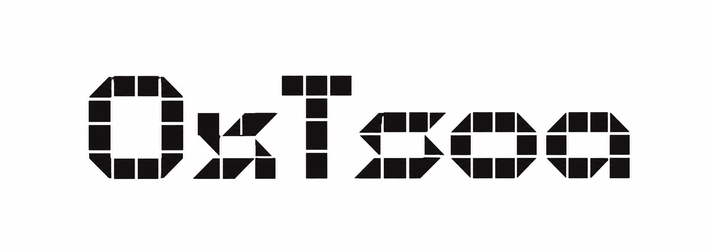
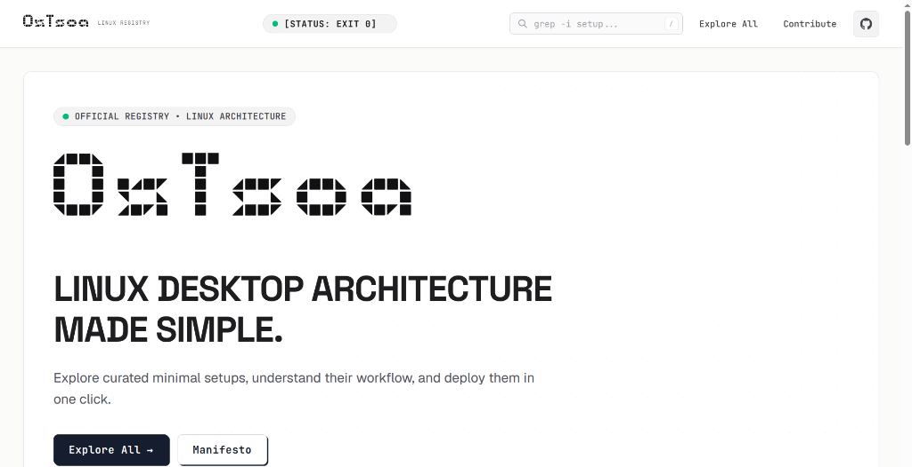
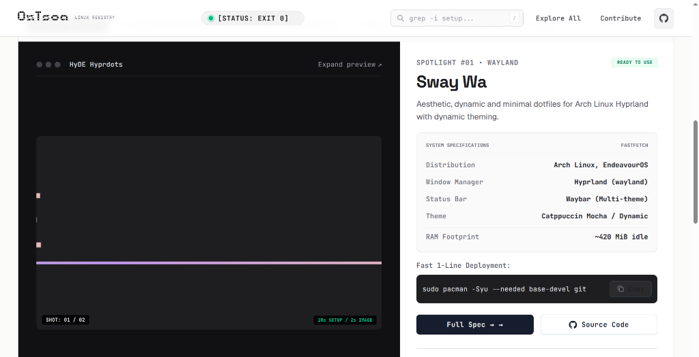
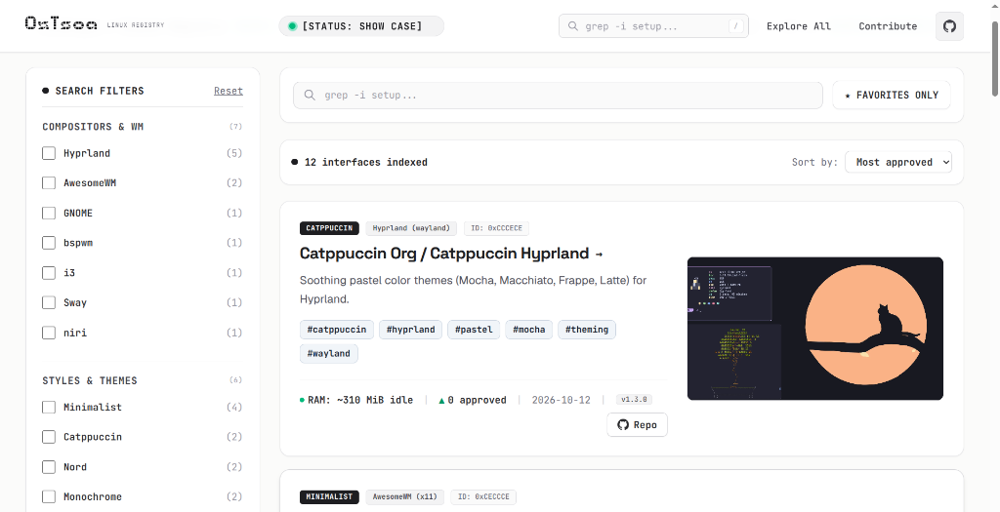
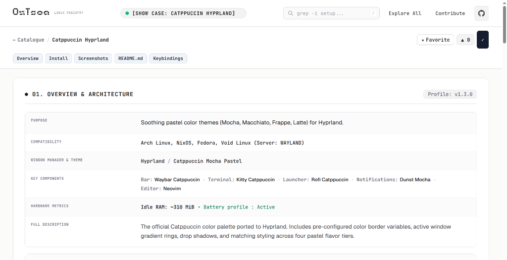
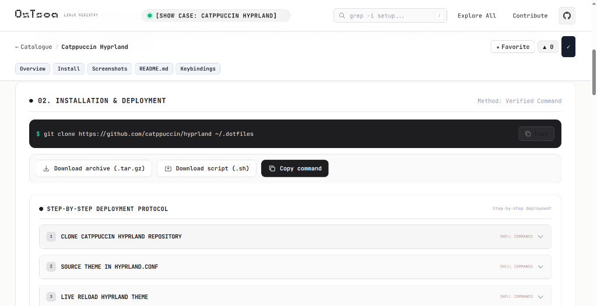

<div align="center">

  <!-- 0xTsoa Authentic BD Brick Logo -->
  <a href="https://nyharena25.github.io/0xtsoa">
    
  </a>

  <h3>LINUX DESKTOP ARCHITECTURE MADE SIMPLE</h3>

  <p>
    <b>The decentralized, open-source Jamstack registry for curated, minimal, and verified Linux desktop configurations.</b><br />
    Inspect authentic hardware metrics, explore reproducible dotfiles, and deploy verified environments with cryptographic integrity.
  </p>

  <!-- Badges Grid: Dynamic JSON, GitHub Metrics & Platform Links -->
  <p>
    <a href="https://nyharena25.github.io/0xtsoa">
      
    </a>
    <a href="https://github.com/nyharena25/0xtsoa/commits/main">
      
    </a>
    <a href="https://github.com/nyharena25/0xtsoa/stargazers">
      
    </a>
    <a href="https://nyharena25.github.io/0xtsoa/index.json">
      
    </a>
    <a href="./LICENSE">
      
    </a>
    <a href="https://github.com/nyharena25/0xtsoa/actions">
      
    </a>
  </p>

  <!-- Interactive Fast Navigation Bar -->
  <p>
    <a href="https://nyharena25.github.io/0xtsoa"><b>Explore Live App ↗</b></a> •
    <a href="#-interactive-showcase--visual-tour"><b>Visual Tour</b></a> •
    <a href="#-core-architecture--specifications"><b>Core Features</b></a> •
    <a href="#-data-flow--architecture"><b>Architecture</b></a> •
    <a href="#-quick-start"><b>Quick Start</b></a> •
    <a href="#-contributing--validation"><b>Contribute</b></a> •
    <a href="#-licences"><b>Licenses</b></a>
  </p>

</div>

---

## ⚡ Executive Summary

**0xTsoa** (*pronounced zero-x-tsoa*) is a next-generation community-driven showcase and architecture registry for Linux environments. It eliminates opaque, fragile dotfiles and replaces them with **declarative, type-safe, and verifiable JSON specifications**.

Every configuration in the registry is:
- **Reproducible**: Pinned to immutable Git commits (`ref: sha`).
- **Cryptographically Secured**: Installation scripts must provide verified **SHA-256** checksum hashes.
- **Serverless & Decentralized**: Powered entirely by the Jamstack (Astro 5 + TypeScript + Tailwind CSS v4). No databases, no tracking cookies, and zero backend maintenance.

> [!NOTE]
> **Live Production Mirror**: Access the public registry directly at [https://nyharena25.github.io/0xtsoa](https://nyharena25.github.io/0xtsoa). The platform is available natively in **French** and **English**.

---

## 📸 Interactive Showcase & Visual Tour

### 01. Landing & Brutalist Brand Identity
*High-contrast "Paper & Ink" aesthetics, bespoke BD Brick typography, and instant status monitoring.*

<div align="center">
  
</div>

- **Design Philosophy**: Tactile 2px black borders, responsive fluid typography (*Space Grotesk*, *Geist*, *JetBrains Mono*), and 0ms instantaneous interactions.
- **Instant Search**: Search through compositors, window managers, authors, and components in real time.

---

### 02. Interactive Desktop Spotlight & Fastfetch Diagnostics
*Live visual previews with hardware metrics, component breakdowns, and single-click deployment commands.*

<div align="center">
  
</div>

- **2s Visual Rhythm**: Automatically cycles through desktop captures every 2 seconds or browse manually.
- **Hardware Footprint**: Direct idle RAM footprint indexing (e.g., `~310-420 MiB idle`), battery profile support, and distro compatibility matrix.
- **1-Line Deployment**: One-click verified deployment command with instant clipboard feedback.

---

### 03. Faceted Search Engine & Multi-Criteria Filtering
*Real-time client-side exploration across window managers, themes, and memory footprints.*

<div align="center">
  
</div>

- **Compositors & Window Managers**: Filter across **Hyprland**, **Sway**, **Niri**, **BSPWM**, **AwesomeWM**, **i3**, and **GNOME**.
- **Styles & Themes**: Gruvbox, Catppuccin, Nord, Tokyo Night, Minimalist, Material You, and Monochrome.
- **Resource Constraints**: Filter setups requiring under 300 MiB of idle RAM or optimized for laptop battery profiles.

---

### 04. Standardized Architecture Specification
*Every dotfiles repository parsed into a unified, transparent architectural breakdown.*

<div align="center">
  
</div>

- **Modular Breakdown**: Clear visibility into Status Bars (Waybar, Quickshell, Polybar), Terminals (Kitty, Foot, Alacritty), App Launchers (Rofi, Fuzzel, Quickshell Grid), and Notification Daemons.
- **Full Transparency**: Distro compatibility badges, display server classification (Wayland / X11), and version tags.

---

### 05. Verifiable Deployment Protocol & Step-by-Step Installation
*Guaranteed safety with cryptographic checksums, automated installers, and shell commands.*

<div align="center">
  
</div>

- **Integrity First**: Automated SHA-256 validation prevents supply-chain tampering.
- **Flexible Deployment**: Choose between 1-line curl commands, shell script downloads (`.sh`), package archives (`.tar.gz`), or granular step-by-step shell accordions.

---

## 🏛️ Core Features

| Feature | Description | Architecture / Implementation |
| :--- | :--- | :--- |
| **100% Jamstack Decoupled** | No MySQL, PostgreSQL, or stateful servers. | Static JSON files in `configs/<author>/<slug>.json` |
| **Cryptographic Safety** | Strict validation of installation scripts. | Mandatory SHA-256 checksums checked during CI |
| **Transparent Sign-Offs** | Community voting powered by GitHub. | Public 👍 reactions on GitHub Discussions |
| **Live Markdown Synced** | Remote author documentation rendered in-place. | Real-time fetch pinned to commit refs with permanent asset rewrites |
| **High Accessibility** | WCAG AAA compliant visual contrast (>12:1). | Tailwind CSS v4 design tokens + semantic HTML |
| **Client Search Engine** | Lightning-fast full-text offline indexing. | [Pagefind](https://pagefind.app/) static search + TypeScript facets |

---

## 🔄 Data Flow & Architecture

The 0xTsoa pipeline connects contributors, GitHub automation, and the static delivery engine:

<div align="center">
  
</div>

<details>
<summary><b>🔍 Click to view Architecture Workflow Details</b></summary>
<br />

1. **Submission**: Contributors submit configurations either via direct Git Pull Request or through guided GitHub Issue Forms (`.github/ISSUE_TEMPLATE/new-config.yml`).
2. **Automated Conversion**: GitHub Actions run [`scripts/issue-to-config.ts`](./scripts/issue-to-config.ts) to convert issue payloads into validated JSON schemas.
3. **CI Validation**: [`scripts/validate-configs.ts`](./scripts/validate-configs.ts) tests schema adherence, checks SHA-256 hashes, and validates remote image assets.
4. **Community Sign-Off**: [`scripts/fetch-votes.ts`](./scripts/fetch-votes.ts) aggregates public 👍 reactions from linked GitHub Discussions at build time.
5. **Static Generation**: Astro 5 compiles all routes into pure HTML/CSS/JS deployed globally on GitHub Pages.
</details>

---

## 🚀 Quick Start

### Prerequisites
- **Node.js**: `v20.0.0` or higher
- **npm**: `v10.0.0` or higher

```bash
# 1. Clone the repository
git clone https://github.com/nyharena25/0xtsoa.git
cd 0xtsoa

# 2. Install dependencies
npm install

# 3. Start local development server (port 4321)
npm run dev

# 4. Run automated test suite (38 unit tests)
npm test

# 5. Validate all configuration files against schema
npm run validate

# 6. Build production static bundle
npm run build
```

---

## 🛠️ Configuration Schema & Contributing

Adding a configuration to 0xTsoa is simple and transparent. Every setup is defined in a standard JSON file validated against [`schema/config.schema.json`](./schema/config.schema.json):

<details>
<summary><b>📋 View Configuration JSON Template</b></summary>

```json
{
  "$schema": "../../schema/config.schema.json",
  "name": "My Hyprland Setup",
  "author": {
    "name": "developer",
    "github": "developer"
  },
  "lang": "en",
  "summary": "Clean and fluid Wayland desktop environment.",
  "license": "MIT",
  "version": "v1.0.0",
  "updatedAt": "2026-10-15",
  "distros": ["arch", "fedora"],
  "wm": "hyprland",
  "themeStyle": "minimalist",
  "displayServer": "wayland",
  "tags": ["hyprland", "wayland", "minimalist"],
  "specs": {
    "bar": "Waybar",
    "terminal": "Kitty",
    "launcher": "Rofi",
    "notifications": "Dunst",
    "theme": "Nordic Dark",
    "shell": "zsh",
    "editor": "Neovim",
    "ramIdleMiB": 320,
    "batteryProfile": true
  },
  "screenshots": [
    {
      "url": "https://raw.githubusercontent.com/user/dots/main/assets/preview.png",
      "alt": "Desktop Overview",
      "caption": "01_DESKTOP_OVERVIEW.RAW"
    }
  ],
  "source": {
    "repo": "https://github.com/user/dots",
    "ref": "9f03f26fc10a00e00ec6b2ac2a41e44d16297548",
    "readme": "README.md"
  },
  "install": {
    "steps": [
      {
        "id": "clone",
        "title": "Clone configuration",
        "commands": ["git clone https://github.com/user/dots.git ~/.dotfiles"]
      }
    ]
  },
  "keybindings": [
    { "keys": "SUPER + RETURN", "action": "exec, kitty", "effect": "Spawn terminal" }
  ],
  "example": false
}
```
</details>

### How to Contribute
1. **GitHub Issue (Recommended for beginners)**: Go to [New Configuration Form](https://github.com/nyharena25/0xtsoa/issues/new?template=new-config.yml), fill out the form, and a bot will automatically open a validated Pull Request for you.
2. **Direct Pull Request**: Create a file at `configs/<your-username>/<your-setup>.json`, run `npm run validate`, and submit your PR.

---

## 📂 Repository Structure

```text
0xTsoa/
├── .github/
│   ├── assets/                   # Official vector logos & screenshot assets
│   ├── workflows/                # CI/CD: build, validate, ingest & vote sync
│   └── ISSUE_TEMPLATE/           # Interactive submission forms
├── configs/                      # Contributed desktop configurations (CC-BY-4.0)
│   ├── catppuccin/
│   ├── end-4/
│   ├── gh0stzk/
│   └── ...
├── public/                       # Static public assets, fonts & fallback SVGs
│   ├── font/                     # BD Brick display typeface
│   └── screenshots/              # Offline brutalist fallback graphics
├── schema/
│   └── config.schema.json        # Official JSON Schema for validation
├── scripts/
│   ├── validate-configs.ts       # CI sanity validator (schemas, hashes, images)
│   ├── fetch-votes.ts            # Synchronizes 👍 reactions from GitHub Discussions
│   ├── issue-to-config.ts        # Parses GitHub Issue forms into valid JSON
│   └── ingest-configs.ts         # Remote repository asset discovery
├── src/
│   ├── components/               # Brutalist UI components (Spotlight, Gallery...)
│   ├── lib/                      # Schema, README parser, voting, filters
│   ├── pages/                    # Astro routes (index, catalogue, specs, i18n)
│   └── styles/global.css         # Tailwind CSS v4 Paper & Ink design tokens
└── tests/                        # Vitest unit test suite
```

---

## 📄 Licences & Attributions

- **Platform Source Code**: Released under the [MIT License](./LICENSE).
- **Registry Configurations (`configs/`)**: Published under [Creative Commons Attribution 4.0 International (CC BY 4.0)](./configs/LICENSE).
- **Dotfiles & Scripts**: Every referenced desktop setup retains the specific upstream software license chosen by its respective author.
- **Typeface**: *BD Brick* designed by [Büro Destruct](https://www.burodestruct.net/).

<br />

<div align="center">
  <sub>Built with precision for the Linux customization community • <b>0xTsoa Registry</b></sub>
</div>
